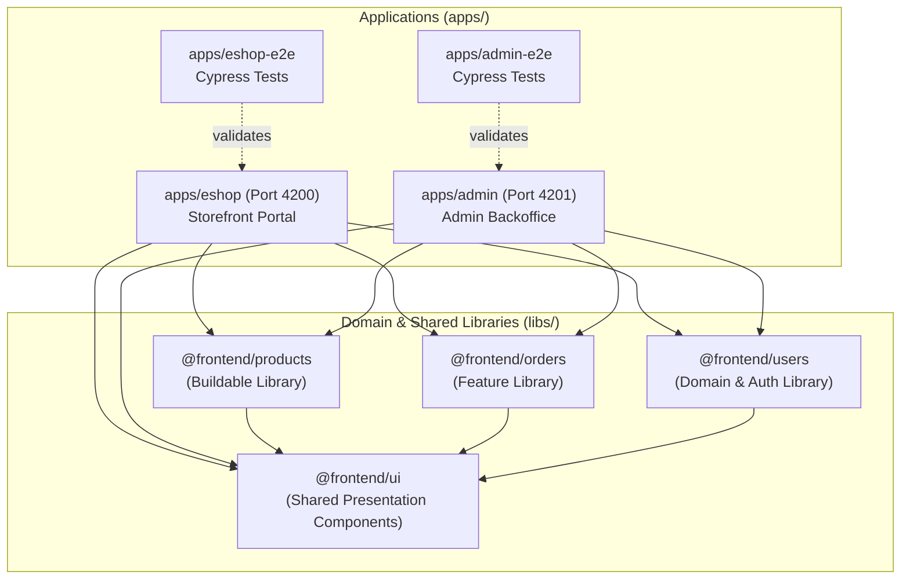

# Frontend Architecture & Workspace Documentation

> **Workspace:** `@frontend/source`  
> **Tooling:** [Nx Monorepo](https://nx.dev) (v24.0.6)  
> **Framework:** Angular (v22.2.0 - Standalone Components)  
> **Testing:** Vitest (Unit) & Cypress (E2E)  
> **Bundler:** Angular Application Builder (`@angular/build:application` - esbuild/Vite)

---

## Table of Contents
1. [Overview & Monorepo Philosophy](#1-overview--monorepo-philosophy)
2. [High-Level Architecture Diagram](#2-high-level-architecture-diagram)
3. [Technology Stack](#3-technology-stack)
4. [Directory Structure](#4-directory-structure)
5. [Applications Breakdown](#5-applications-breakdown)
6. [Libraries Breakdown (`libs/`)](#6-libraries-breakdown-libs)
7. [Module Boundaries & Path Mapping](#7-module-boundaries--path-mapping)
8. [Nx Configuration & Task Pipeline](#8-nx-configuration--task-pipeline)
9. [Developer Guide & CLI Commands](#9-developer-guide--cli-commands)
10. [Windows PowerShell Tips](#10-windows-powershell-tips)
11. [Recommended `package.json` Scripts](#11-recommended-packagejson-scripts)
12. [Full-Stack Integration (Backend Connection)](#12-full-stack-integration-backend-connection)

---

## 1. Overview & Monorepo Philosophy

The `frontend` directory is organized as an **Nx integrated monorepo**. It hosts multiple Angular web applications alongside a suite of domain-specific and reusable shared libraries.

### Core Principles
- **Code Sharing without Duplication:** Common components (e.g., UI widgets, designs) and business logic (e.g., product models, user auth state) are encapsulated inside `libs/` and consumed by both `admin` and `eshop` applications.
- **Strict Boundaries:** TypeScript paths (`@frontend/*`) and ESLint boundary rules prevent spaghetti dependencies and enforce modular boundaries.
- **Incremental Builds & Computation Caching:** Nx tracks file hashes and execution inputs. Unchanged libraries and applications are restored instantly from cache.
- **Scalable Architecture:** New features can be generated as independent libraries (`libs/`) without bloating application roots.

---

## 2. High-Level Architecture Diagram



---

## 3. Technology Stack

| Layer | Technology | Version | Purpose / Details |
| :--- | :--- | :--- | :--- |
| **Monorepo Engine** | Nx | `24.0.6` | Task runner, graph analyzer, computation caching, code generators |
| **Frontend Framework** | Angular | `~22.2.0` | Standalone components, signals, Angular 22 control flow |
| **Language** | TypeScript | `~6.0.3` | Strong typing across entire codebase |
| **Application Bundler** | `@angular/build:application` | `~22.2.0` | High-performance esbuild/Vite-based modern pipeline |
| **Library Packaging** | `ng-packagr` / `ng-packagr-lite` | `~22.2.0` | Secondary packaging for buildable libraries (`products`) |
| **Unit Testing** | Vitest (`vitest-angular`) | `^4.0.8` | Fast in-memory unit tests |
| **E2E Testing** | Cypress | `^16.0.0` | End-to-end browser automation for each app |
| **Linting & Formatting**| ESLint (Flat Config) & Prettier | `9.8.0` / `3.6.2` | Linting with `@nx/enforce-module-boundaries` |
| **Styling** | SCSS / CSS | - | SCSS for apps, modular CSS for libraries |

---

## 4. Directory Structure

```text
frontend/
├── apps/
│   ├── admin/                 # Admin backoffice application (Angular)
│   │   ├── src/               # Application code (main.ts, app.ts, app.routes.ts)
│   │   ├── project.json       # Project configuration (targets: build, serve, test)
│   │   └── tsconfig.app.json  # TypeScript configuration for app
│   ├── admin-e2e/             # Cypress E2E test suite for admin
│   │   ├── cypress.config.ts  # Cypress runner configuration
│   │   └── src/e2e/app.cy.ts  # End-to-end spec files
│   ├── eshop/                 # Customer-facing e-commerce storefront (Angular)
│   │   ├── src/               # Storefront application source
│   │   └── project.json       # Build, serve, test targets
│   └── eshop-e2e/             # Cypress E2E suite for eshop
├── libs/
│   ├── orders/                # Orders management library (@frontend/orders)
│   │   ├── src/lib/orders/    # Orders standalone component and logic
│   │   └── project.json       # Inferred library target configuration
│   ├── products/              # Products catalog library (@frontend/products)
│   │   ├── ng-package.json    # ng-packagr configuration (buildable)
│   │   ├── package.json       # Isolated package definition
│   │   └── src/lib/products/  # Products component and unit tests
│   ├── ui/                    # Reusable UI component library (@frontend/ui)
│   │   └── src/lib/ui/        # Buttons, cards, layouts, dialogs
│   └── users/                 # Users & Auth library (@frontend/users)
│       └── src/lib/users/     # User profile, login, authentication services
├── eslint.config.mjs          # Workspace-wide ESLint flat configuration
├── nx.json                    # Workspace execution rules, plugins, caching & generators
├── package.json               # Monorepo dependencies and root package descriptor
├── tsconfig.base.json         # Workspace TypeScript paths (@frontend/*)
└── README.md                  # Quickstart documentation
```

---

## 5. Applications Breakdown

### 1. `apps/eshop`
* **Type:** Angular Standalone Application
* **Audience:** End customers / shoppers
* **Source Root:** `apps/eshop/src`
* **Default Port:** `4200`
* **Style:** SCSS (`apps/eshop/src/styles.scss`)
* **Key Targets:**
  * `serve`: Dev server with live reload.
  * `build`: Production optimized bundle in `dist/apps/eshop`.
  * `test`: Vitest unit tests.
  * `serve-static`: Static file preview of the built browser output.

### 2. `apps/admin`
* **Type:** Angular Standalone Application
* **Audience:** Store administrators, warehouse managers
* **Source Root:** `apps/admin/src`
* **Default Port:** `4200` *(Run with `--port=4201` when running concurrently with `eshop`)*
* **Style:** SCSS (`apps/admin/src/styles.scss`)
* **Key Targets:**
  * `serve`: Dev server.
  * `build`: Production optimized bundle in `dist/apps/admin`.
  * `test`: Vitest unit tests.

### 3. `apps/eshop-e2e` & `apps/admin-e2e`
* **Type:** Cypress E2E automation apps
* **Relationship:** Implicit dependencies on their respective application (`admin` and `eshop`).
* **Feature:** Automatic dev-server launching when running Cypress specs.

---

## 6. Libraries Breakdown (`libs/`)

Libraries are designed according to domain boundaries:

| Library Path | Package Import Alias | Library Type | Purpose |
| :--- | :--- | :--- | :--- |
| `libs/products` | `@frontend/products` | **Buildable Library** | Product listing, details, catalog, search, and pricing logic. Packaged via `@nx/angular:ng-packagr-lite`. |
| `libs/orders` | `@frontend/orders` | **Feature Library** | Shopping cart, checkout flow, payment handling, and order tracking. |
| `libs/users` | `@frontend/users` | **Domain / Auth Library** | User registration, login, JWT token management, profile screens. |
| `libs/ui` | `@frontend/ui` | **Shared UI Library** | Domain-agnostic design system components (buttons, navbars, banners, badges). |

### Standalone Component Pattern
Every component in the workspace uses Angular 22's standalone format:
```typescript
import { Component } from '@angular/core';

@Component({
  selector: 'lib-ui',
  imports: [],
  templateUrl: './ui.html',
  styleUrl: './ui.css',
})
export class Ui {}
```

---

## 7. Module Boundaries & Path Mapping

### TypeScript Path Mappings (`tsconfig.base.json`)
Allows cleanly importing libraries across any app or library without relative `../../` paths:
```json
"paths": {
  "@frontend/products": ["./libs/products/src/index.ts"],
  "@frontend/orders": ["./libs/orders/src/index.ts"],
  "@frontend/users": ["./libs/users/src/index.ts"],
  "@frontend/ui": ["./libs/ui/src/index.ts"]
}
```

### Dependency Rules (`eslint.config.mjs`)
The workspace enforces boundaries using `@nx/enforce-module-boundaries`:
- **Circular Dependency Guard:** Prevents circular references between libraries.
- **Buildable Library Enforcement:** `enforceBuildableLibDependency: true` ensures buildable libraries do not import non-buildable internal libraries.
- **Tags Strategy:** You can define tags in `project.json` (e.g. `tags: ["scope:eshop"]` or `tags: ["type:ui"]`) to prevent domain leakage.

---

## 8. Nx Configuration & Task Pipeline

Defined in `nx.json`:
- **Default Base Branch:** `master`
- **Inferred Target Plugins:**
  - `@nx/eslint/plugin`: Automatically maps `lint` tasks.
  - `@nx/cypress/plugin`: Automatically infers `e2e`, `open-cypress`, and `component-test` targets.
- **Cache Inputs & Target Defaults:**
  - `build` tasks cache outputs and automatically run dependent builds (`dependsOn: ["^build"]`).
  - Unit tests cache results based on project files and production dependencies.
- **Default Generators:** Configured to generate SCSS for apps, ESLint for linting, and Vitest for testing.

---

## 9. Developer Guide & CLI Commands

> **Note for Windows Users:** See [Windows PowerShell Tips](#10-windows-powershell-tips) if `npx` throws an execution policy error.

### 1. Serving Applications Locally
```bash
# Start eshop storefront (default port 4200)
npx nx serve eshop

# Start admin portal on port 4201 (avoiding port clash)
npx nx serve admin --port=4201
```

### 2. Building Applications & Libraries
```bash
# Build eshop for production
npx nx build eshop --configuration=production

# Build admin portal
npx nx build admin --configuration=production

# Build the products library
npx nx build products

# Build all applications and buildable libraries at once
npx nx run-many -t build
```

### 3. Running Unit Tests
```bash
# Test a specific project
npx nx test eshop
npx nx test products

# Test all projects
npx nx run-many -t test
```

### 4. Running End-to-End (E2E) Tests
```bash
# Headless Cypress run
npx nx e2e eshop-e2e
npx nx e2e admin-e2e

# Interactive Cypress Test Runner UI
npx nx open-cypress eshop-e2e
```

### 5. Linting & Formatting
```bash
# Lint specific project
npx nx lint eshop

# Lint entire workspace
npx nx run-many -t lint

# Check formatting with Prettier
npx prettier --check "apps/**/*.{ts,html,scss}" "libs/**/*.{ts,html,css}"
```

### 6. Visualizing Architecture (Nx Graph)
```bash
# Open interactive dependency graph in browser
npx nx graph
```

### 7. Affected Commands (CI/CD Acceleration)
Nx can determine exactly which applications and libraries were affected by a Git commit or branch:
```bash
# Test only affected projects against master
npx nx affected -t test

# Build only affected projects
npx nx affected -t build
```

### 8. Generating New Code
```bash
# Generate a new shared library
npx nx g @nx/angular:lib my-new-feature

# Generate a new component inside an existing library
npx nx g @nx/angular:component my-component --project=ui
```

---

## 10. Windows PowerShell Tips

If running `npx nx ...` inside PowerShell produces the error:
`File C:\Program Files\nodejs\npx.ps1 cannot be loaded because running scripts is disabled on this system`

Use either of these two solutions:
1. **Prefix with `cmd /c`:**
   ```powershell
   cmd /c npx nx serve eshop
   ```
2. **Or adjust PowerShell execution policy for current user:**
   ```powershell
   Set-ExecutionPolicy -ExecutionPolicy RemoteSigned -Scope CurrentUser
   ```

---

## 11. Recommended `package.json` Scripts

To make life easier for developers, you can add shorthand scripts to `frontend/package.json`:

```json
"scripts": {
  "start:eshop": "nx serve eshop",
  "start:admin": "nx serve admin --port=4201",
  "build:eshop": "nx build eshop --configuration=production",
  "build:admin": "nx build admin --configuration=production",
  "build:all": "nx run-many -t build",
  "test:all": "nx run-many -t test",
  "lint:all": "nx run-many -t lint",
  "e2e:eshop": "nx e2e eshop-e2e",
  "e2e:admin": "nx e2e admin-e2e",
  "graph": "nx graph"
}
```

---

## 12. Full-Stack Integration (Backend Connection)

Your repository contains a backend in `../backend` built with Node.js, Express, TypeScript, and MongoDB.

### Local Development API Proxy
To avoid CORS issues and enable transparent API calls from `eshop` and `admin` to your backend (`http://localhost:3000` or whatever port your backend runs on), create a `proxy.conf.json` in `apps/eshop/` and `apps/admin/`:

```json
{
  "/api": {
    "target": "http://localhost:3000",
    "secure": false,
    "changeOrigin": true
  }
}
```

Then in `project.json` for `apps/eshop` (under `targets.serve.options`):
```json
"options": {
  "proxyConfig": "apps/eshop/proxy.conf.json"
}
```
Now requests to `/api/*` from the Angular storefront or admin panel automatically route to the Express backend.
